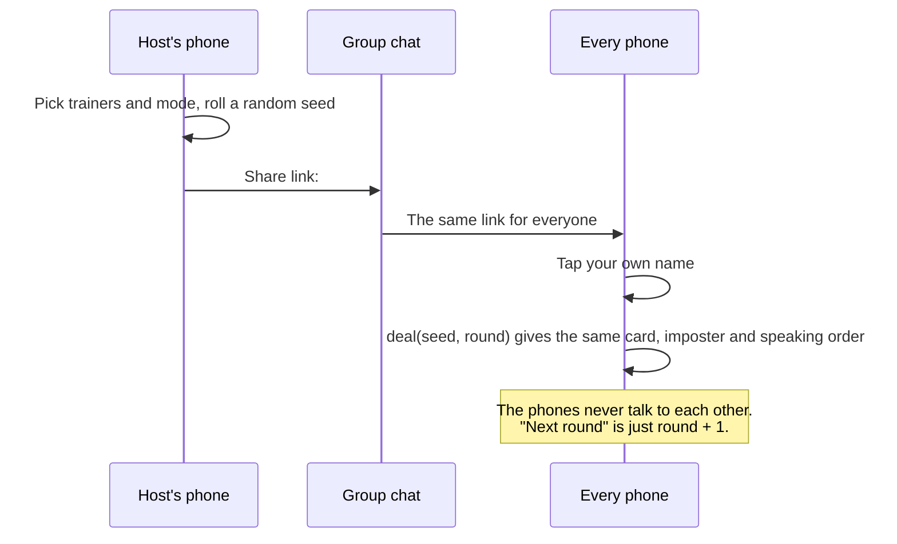

<p align="center">
  <a href="https://pokeimposter.vercel.app"></a>
</p>

<p align="center">
  <a href="https://pokeimposter.vercel.app"></a>
</p>

<p align="center">
  
  
  
  
  
  
</p>

<p align="center"><b>One link. Everyone gets the same secret card… except the imposter.</b><br>
Say one word each, vote, and catch the Ditto before it fools you.</p>

<p align="center">
  
  
  
  
  
</p>

---

## 🎮 How to play

1. **One trainer sets up a game** at [pokeimposter.vercel.app](https://pokeimposter.vercel.app): names, mode, card types, generations.
2. **Share the link** in your group chat. Everyone opens the *same* link and taps their own name.
3. **Hold the card to peek.** Everyone has the same Pokémon, Move, Ability or Item, except the imposter.
4. **Go around in speaking order.** Each trainer says **one word** about their card. Too obvious and the imposter catches on; too vague and you look suspicious.
5. **Vote out loud**, then tap **Reveal**. A caught Ditto gets one guess at the card to steal the win.
6. Tap **Next round →**. Everyone's phone deals the same new round.

Built for game nights with Hassan and Arafat. Works for 3–12 trainers on a voice call or in the same room.

## 🎭 Modes


| Mode | The imposter… | The vibe |
|---|---|---|
| 🟣 **Who's the Ditto?** | knows they're the Ditto, but only sees the **category** (e.g. "it's a Move") | Bluff. Listen to the first clue, then transform and blend in. |
| 🚀 **Team Rocket Spy**: *Sneaky* | gets a **different card that shares a type** (or item group) and **doesn't know** they're the spy | Charizard vs. Arcanine. Everyone's clues kind of fit… |
| 🚀 **Team Rocket Spy**: *Sloppy* | gets **any other card from the same category** and doesn't know | Charizard vs. Wooper. Chaos. Jessie and James would be proud. |

With 5 or more trainers you can add a second imposter (up to just under half the table). Multiple spies share the same decoy card.

<br clear="right">

## ✨ How three phones agree with no server

The game never talks to a server while you play. The host's link carries the game settings and a random **seed**, and every phone runs the same deterministic deal:



- **Same input, same output.** A seeded [mulberry32](src/engine/rng.ts) PRNG with Fisher–Yates shuffles uses integer math only, so every browser deals the same round. `Math.random` is never used in the deal.
- **Same cards everywhere.** The card pool is bundled into the app at build time, so there's no API call during the game. A data-version stamp in the link means an old link gets *"start a new game"* instead of quietly dealing different cards.
- **Private by design.** Settings live in the URL `#hash`, which browsers never send to the server.
- **Stay in sync** by checking the **Game tag** (e.g. `Game H55A`) and the **round number** out loud.

## 📚 The card pool

Fetched once from the [PokeAPI GraphQL API](https://pokeapi.co/docs/graphql) by [`scripts/build-data.mjs`](scripts/build-data.mjs) and filtered for game night:

| Category | Cards | Filter |
|---|---:|---|
| Pokémon | 1,025 | every species (default form), Gen I–IX |
| Moves | 847 | no Z-Moves, Max/G-Max moves or Shadow moves |
| Abilities | 313 | main-series only |
| Items | 404 | familiar groups: balls, potions, berries, evolution and held items… (no TMs or key items) |

The host can narrow it to specific generations and card types. Want something gone? Add its slug to [`src/data/blocklist.json`](src/data/blocklist.json) and run `npm run data`.

## 🛠️ Run it locally

```bash
git clone https://github.com/Rasheed-Al-Qobbaj/pokeimposter.git
cd pokeimposter
npm install
npm run dev        # http://localhost:5173
```

| Script | What it does |
|---|---|
| `npm run dev` | Start the dev server |
| `npm test` | Engine tests: determinism, fairness, mode rules (Vitest) |
| `npm run build` | Type-check and build to `dist/` |
| `npm run data` | Re-fetch the card pool from PokeAPI |
| `npm run og` | Re-render the banner, link preview and icon from `public/logo.svg` |
| `npm run shots` | Re-capture the README screenshots (needs Chrome and a running dev server) |

**Deploy your own:** it's a static site, so any host works. On Vercel's free Hobby plan:

[](https://vercel.com/new/clone?repository-url=https://github.com/Rasheed-Al-Qobbaj/pokeimposter)

## 🗂️ Project layout

```
src/engine/   rng.ts, code.ts (the link), deal.ts (the deal), pools.ts (cards). Pure and tested.
src/ui/       setup, pick-your-name, and table (card + reveal) screens
src/data/     bundled card pool from PokeAPI + blocklist
scripts/      build-data, render-images, screenshots
```

## 🙏 Credits

- Card data and sprites from [PokeAPI](https://pokeapi.co) and [PokeAPI/sprites](https://github.com/PokeAPI/sprites).
- Fonts: [Fredoka](https://fonts.google.com/specimen/Fredoka) via Google Fonts.

> PokeImposter is an unofficial, non-commercial fan project. It isn't affiliated with or endorsed by Nintendo, Creatures Inc., GAME FREAK inc. or The Pokémon Company. Pokémon and all related names and images are trademarks and © of their respective owners.

Code released under the [MIT License](LICENSE).
