<p align="center">
  <a href="https://pokeimposter.vercel.app">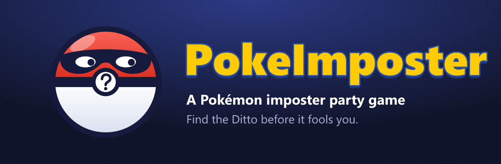</a>
</p>

<p align="center">
  <a href="https://pokeimposter.vercel.app"></a>
</p>

<p align="center">
  
  
  
  
  
  
</p>

<h3 align="center">Find the Ditto before it fools you.</h3>

<p align="center">
  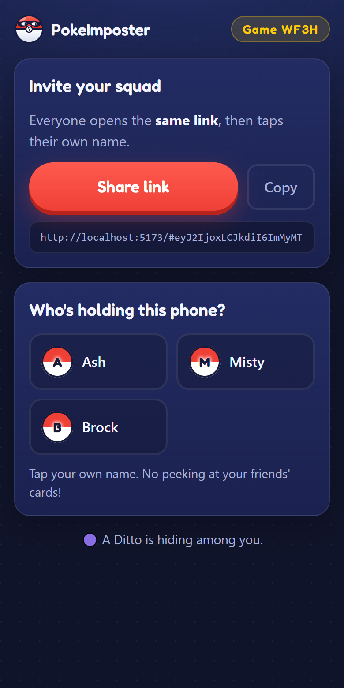
  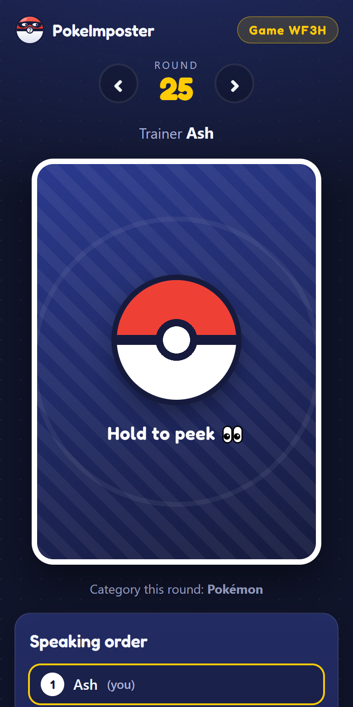
  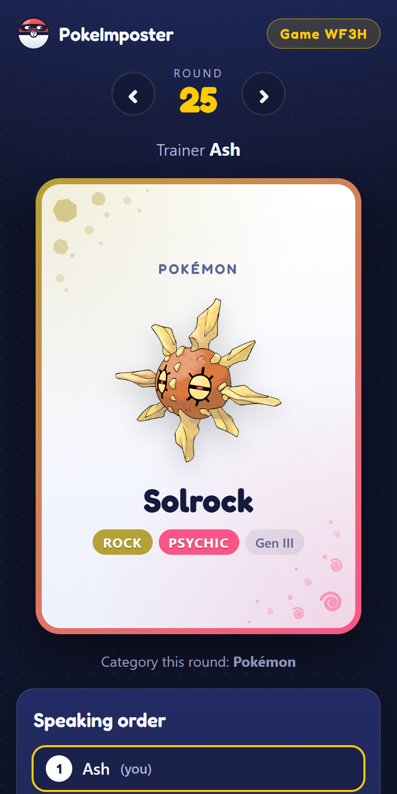
  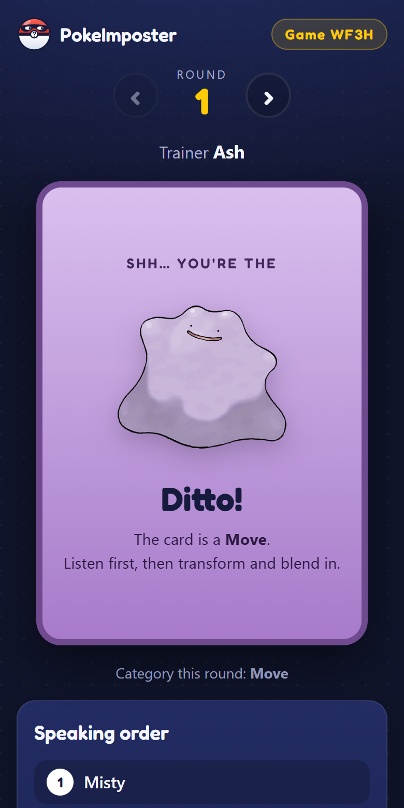
  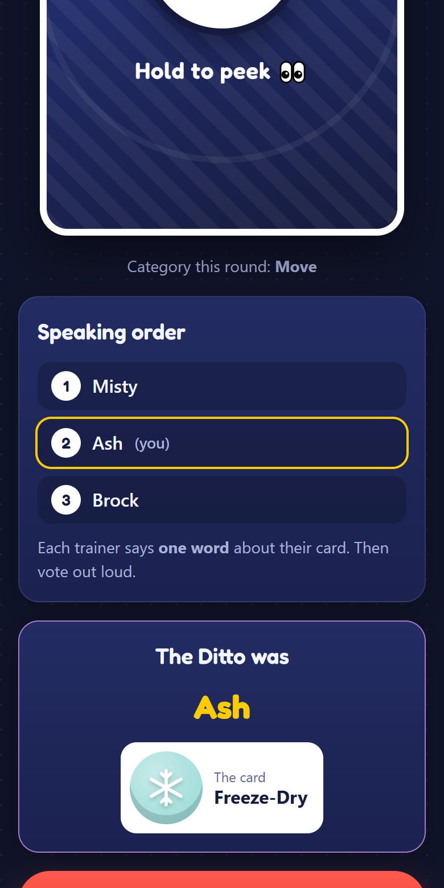
</p>

---

## 🎮 How to play

1. **One trainer sets up a game** at [pokeimposter.vercel.app](https://pokeimposter.vercel.app): names, mode, card types, generations.
2. **Share the link** in your group chat. Everyone opens the *same* link and taps their own name.
3. **Hold the card to peek.** Everyone has the same Pokémon, Move, Ability or Item, except the imposter.
4. **Go around in speaking order.** Each trainer says **one word** about their card. Too obvious and the imposter catches on; too vague and you look suspicious.
5. **Vote out loud**, then tap **Reveal**. A caught Ditto gets one guess at the card to steal the win.
6. Tap **Next round →**. Every phone deals the same new round.

Works for 3–12 trainers on a voice call or in the same room.

## 🃏 The cards

<p align="center">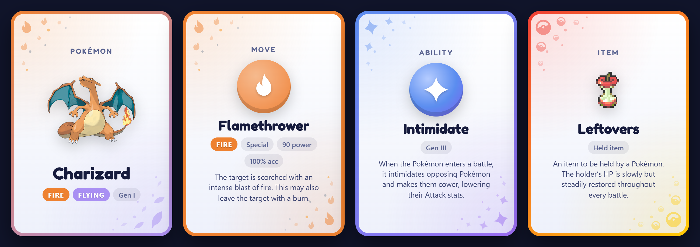</p>

Every card is dressed in its type: **droplets** for Water, **flames and ash** for Fire, snowflakes for Ice, bolts for Electric, spirals for Psychic, all 18 types. A **dual-type** Pokémon wears one type in each corner, with a border that blends the two (Charizard above: Fire meets Flying). **Moves**, **abilities** and **items** show their in-game description, so nobody needs to remember what a Shell Bell does. Moves also show their power and accuracy.

## 🎭 Modes

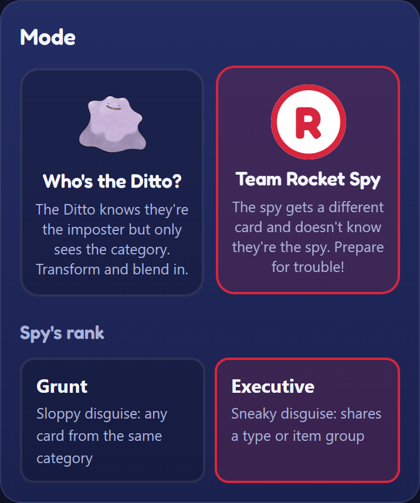

| Mode | The imposter… | The vibe |
|---|---|---|
| 🟣 **Who's the Ditto?** | knows they're the Ditto, but only sees the **category** (e.g. "it's a Move") | Bluff. Listen to the first clue, then transform and blend in. |
| 🚀 **Team Rocket Spy**, *Executive* rank | gets a **different card that shares a type** (or item group) and **doesn't know** they're the spy | Charizard vs. Arcanine. Everyone's clues kind of fit… |
| 🚀 **Team Rocket Spy**, *Grunt* rank | gets **any other card from the same category** and doesn't know | Charizard vs. Wooper. A Grunt's disguise fools no one. Or does it? |

With 5 or more trainers you can add a second imposter (up to just under half the table). Multiple spies share the same decoy card.

<br clear="right">

## ✨ How every phone gets the same game, with no server

The game never talks to a server while you play. The host's link carries the settings and a random **seed**, and every phone runs the same deterministic `deal(seed, round)`:

<p align="center">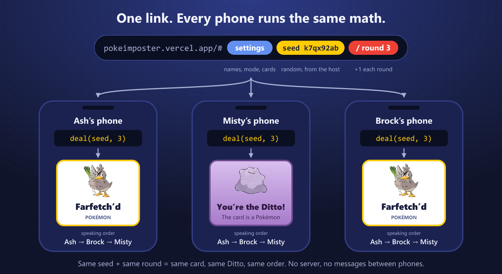</p>

Inside `deal`, the seed turns into a stream of random numbers, and each number makes one decision. Here's the real trace of round 3 of game `k7qx92ab` (a test in [`deal.test.ts`](src/engine/deal.test.ts) keeps this figure honest):

<p align="center">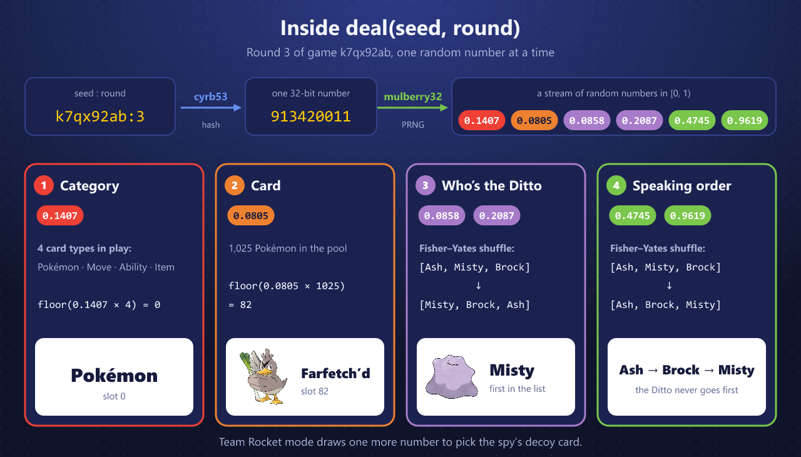</p>

### 🎲 What's a PRNG, and why mulberry32?

A **pseudo-random number generator** is a small formula whose numbers *look* random but are entirely decided by where it starts (the **seed**). Same seed, same numbers, on every device. That's exactly what three phones need. `Math.random()` can't be seeded, and every browser implements it differently, so it can't keep phones in sync.

[**mulberry32**](https://gist.github.com/tommyettinger/46a874533244883189143505d203312c) (by Tommy Ettinger) keeps a single 32-bit number as its state. Every call:

1. **adds** the odd constant `0x6D2B79F5` to the state, which steps it through every 32-bit value before it ever repeats,
2. **scrambles** a copy with multiplications (`Math.imul`), bit shifts and XORs, and
3. **divides** by 2³² to land in `[0, 1)`.

```ts
// src/engine/rng.ts
export function mulberry32(seed: number): Rng {
  let a = seed >>> 0;
  return () => {
    a = (a + 0x6d2b79f5) >>> 0;
    let t = a;
    t = Math.imul(t ^ (t >>> 15), t | 1);
    t ^= t + Math.imul(t ^ (t >>> 7), t | 61);
    return ((t ^ (t >>> 14)) >>> 0) / 4294967296;
  };
}
```

It's all 32-bit integer math, so every JavaScript engine computes the exact same bits. Its author gives it a period of exactly 2³² numbers, and a round with three trainers uses six. It isn't cryptographically secure, which is fine for a party game among friends.

### 🔑 cyrb53: a fresh seed for every round

Each round hashes the text `seed:round` (like `k7qx92ab:3`) with [**cyrb53**](https://github.com/bryc/code/blob/master/jshash/experimental/cyrb53.js), a fast string hash by bryc, into the 32-bit number that seeds mulberry32. Round 7 never depends on rounds 1–6, so anyone can jump straight to a round, and refreshing the page can't knock a phone out of sync.

### 🔀 Fisher–Yates: a fair shuffle

To pick the Ditto, the trainers are shuffled and **whoever lands first is the Ditto** (with 2 imposters, the first two). The speaking order is a second shuffle.

<p align="center">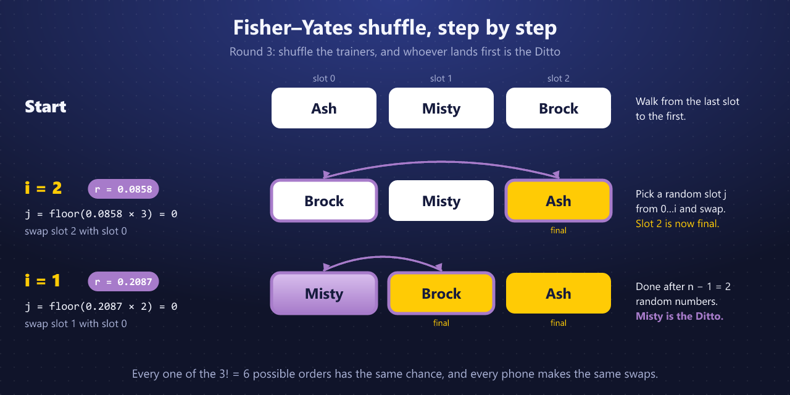</p>

Walk from the **last slot to the first**. At slot `i`, pick a random slot `j` from `0…i` with `j = floor(r × (i + 1))`, and swap. Everything behind you is final. That takes exactly *n − 1* random numbers, and as long as they're uniform, every one of the *n!* orders is equally likely, so every trainer has the same chance of being the Ditto. This is the in-place version published by Richard Durstenfeld ([*Algorithm 235: Random permutation*, CACM 7(7), 1964](https://doi.org/10.1145/364520.364540)).

**Why not `list.sort(() => Math.random() - 0.5)`?** It looks like a shuffle, but sorting algorithms expect a consistent comparison. Random answers give lopsided results (see Mike Bostock's [*Will It Shuffle?*](https://bost.ocks.org/mike/shuffle/compare.html)). And since browsers use different sorting algorithms, two phones could get different orders from the very same random numbers.

### 🔒 The small print

- **Same cards everywhere.** The card pool is bundled into the app at build time, so no API is called during the game. A data-version stamp in the link means an old link shows *"start a new game"* instead of quietly dealing different cards.
- **Private by design.** Everything lives in the URL `#hash`, which browsers never send to a server.
- **Stay in sync** by checking the **Game tag** (e.g. `Game H55A`) and the **round number** out loud.

## 📚 The card pool

Fetched once from the [PokeAPI GraphQL API](https://pokeapi.co/docs/graphql) by [`scripts/build-data.mjs`](scripts/build-data.mjs) and filtered for game night:

| Category | Cards | Filter |
|---|---:|---|
| Pokémon | 1,025 | every species (default form), Gen I–IX |
| Moves | 847 | no Z-Moves, Max/G-Max moves or Shadow moves |
| Abilities | 313 | main-series only |
| Items | 404 | familiar groups: balls, potions, berries, evolution and held items… (no TMs or key items) |

Descriptions are each card's newest English in-game text from PokeAPI (falling back to PokeAPI's short effect), loaded lazily so the first screen stays fast. A few of the newest Gen IX moves and items have no English text in PokeAPI yet, so their cards show without one.

The host can narrow the pool to specific generations and card types. Want something gone? Add its slug to [`src/data/blocklist.json`](src/data/blocklist.json) and run `npm run data`.

## 🛠️ Run it locally

```bash
git clone https://github.com/Rasheed-Al-Qobbaj/pokeimposter.git
cd pokeimposter
npm install
npm run dev        # http://localhost:5173
```

| Script | What it does |
|---|---|
| `npm run dev` | Start the dev server |
| `npm test` | Engine tests: determinism, fairness, mode rules, the README example (Vitest) |
| `npm run build` | Type-check and build to `dist/` |
| `npm run data` | Re-fetch the card pool and descriptions from PokeAPI |
| `npm run og` | Re-render the banner, link preview and icon from `public/logo.svg` |
| `npm run figures` | Re-render the "how it works" figures |
| `npm run shots` | Re-capture the screenshots and card gallery (needs Chrome and a running dev server) |

**Deploy your own:** it's a static site, so any host works. On Vercel's free Hobby plan:

[](https://vercel.com/new/clone?repository-url=https://github.com/Rasheed-Al-Qobbaj/pokeimposter)

## 🗂️ Project layout

```
src/engine/   rng.ts, code.ts (the link), deal.ts (the deal), pools.ts (cards). Pure and tested.
src/ui/       setup, pick-your-name and table screens; cards.ts + motifs.ts (card faces and type art)
src/data/     bundled card pool and descriptions from PokeAPI, plus the blocklist
scripts/      build-data, render-images, render-figures, screenshots
```

## 🙏 Credits

- Card data, descriptions and sprites from [PokeAPI](https://pokeapi.co) and [PokeAPI/sprites](https://github.com/PokeAPI/sprites).
- [mulberry32](https://gist.github.com/tommyettinger/46a874533244883189143505d203312c) by Tommy Ettinger · [cyrb53](https://github.com/bryc/code/blob/master/jshash/experimental/cyrb53.js) by bryc.
- Fonts: [Fredoka](https://fonts.google.com/specimen/Fredoka) via Google Fonts.

> PokeImposter is an unofficial, non-commercial fan project. It isn't affiliated with or endorsed by Nintendo, Creatures Inc., GAME FREAK inc. or The Pokémon Company. Pokémon and all related names and images are trademarks and © of their respective owners.

Code released under the [MIT License](LICENSE).
